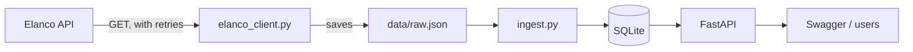

# Tick Sightings Backend

Aqlan Naqib, Elanco Placement Programme 2026 technical task (backend option)

This project pulls tick sighting data from the Elanco API, cleans it, stores it in my own database and serves it through a REST API. You can search and filter sightings, get counts per region and over time, check the quality of the last data load, and see months where a city had an unusual spike in sightings.

I picked the backend task because I've used FastAPI before and I enjoy the data side of things more than UI work.

Stack: Python, FastAPI, SQLModel with SQLite, httpx and pytest.


## Running it

You'll need Python 3.11 or newer.

```bash
git clone https://github.com/AqlanNaqib/elanco-tick-backend.git
cd elanco-tick-backend
python -m venv .venv

# Windows (PowerShell)
.venv\Scripts\Activate.ps1
# Mac / Linux
source .venv/bin/activate

pip install -r requirements.txt
python -m app.refresh                         # fetch and load the data
uvicorn app.main:app --reload --port 8080     # start the API
```

Then go to http://localhost:8080/docs to try everything in Swagger.

To run the tests:

```bash
python -m pytest -v
```

I'm using port 8080 because something on my laptop was already using 8000 (I got `WinError 10013`). Any free port is fine.


## Endpoints

- `GET /health` checks the API is up
- `GET /sightings` searches sightings. Filters: `start`, `end`, `location`, `species`. Paged with `limit` and `offset`
- `GET /sightings/{id}` gets one sighting (404 if it doesn't exist)
- `GET /stats/regions` counts sightings per UK region, with a breakdown by city
- `GET /stats/trends` counts sightings per `week` or `month`, with the same filters as above
- `GET /stats/data-quality` shows what happened on the last data load
- `GET /insights/spikes` lists months where a city had a lot more sightings than usual

City and species filters ignore capitals, so `london` works. The end date includes the whole day.

A few to try:

```
/sightings?location=sheffield&start=2024-01-01
/stats/trends?interval=week&location=London
/insights/spikes?threshold=2.5
```


## How it works



The main idea is that I fetch the data once and then work from my own copy. The Elanco API is rate limited, can return 500 errors and is read-only, so calling it every time someone uses my API would be slow and would break whenever Elanco has a problem. With my own database I can add indexes, do the filtering and counting myself, and keep working even if Elanco is down.

Step by step:

1. `elanco_client.py` gets everything from `/tick-sightings` in one call, plus `/stats` so I can check I got the full count. If it gets a 429, a 5xx or a network error it waits and tries again (2 seconds, then 4). A 404 isn't retried because it won't fix itself.
2. `refresh.py` saves the response to `data/raw.json`. If Elanco still fails after 3 tries, it uses the last saved copy instead.
3. `schemas.py` uses Pydantic to reject anything with missing fields, empty values, bad dates or dates in the future.
4. `cleaning.py` tidies up spacing and capitals so " london " and "London" end up as the same city.
5. `ingest.py` saves everything to SQLite. It updates a row if the id already exists and adds it if not, so running it twice doesn't double the data. If two records have the same date, city and species under different ids, the second one is treated as a duplicate. Anything rejected is kept in its own table with the reason.
6. `main.py` is the FastAPI app, which only ever reads from my database.

Every row has a `source` column set to `elanco`. The idea is that if people could submit their own sightings later, those would be `user` rows, and a refresh from Elanco would never overwrite them.


## The data

Before writing the pipeline I went through the 1,000 records to see what I was dealing with. Honestly, it was cleaner than I expected. There were no missing fields, no duplicates, no bad dates (everything is between January 2012 and December 2024), 14 cities spelled the same way every time, and 5 species that always had the same Latin name. The 1,000 I received matched the total from `/stats`.

I still built the validation and duplicate handling, because the brief asks for it and real data doesn't usually stay this tidy. I tested it with some deliberately broken records to make sure it actually catches things.


## Some decisions I made

**SQLite instead of Postgres.** It needs no setup, so anyone can clone this and run it straight away. Because I'm using SQLModel, switching to Postgres would mostly be a case of changing the connection string.

**Keeping the incoming format separate from the stored format.** `schemas.py` describes what Elanco sends and `models.py` describes what I store. If Elanco renamed a field, I'd only need to change one place.

**Doing the counting in the database.** The region and trend endpoints use SQL `GROUP BY` instead of loading everything into Python. Along with indexes on date, location and species, and paging on `/sightings` (max 200 per page), this should hold up much better with a bigger dataset.

**Mapping cities to regions.** The data only has city names, but the brief asks for sightings per region, so `regions.py` maps each city to its UK region.

**Not showing internal errors.** If something unexpected breaks, the full error goes to the logs but the user just sees "Internal server error". Stack traces can give away things you don't want people to see.

**No update or delete endpoints.** This is meant to be public health data, so letting anyone edit or delete records without logging in would be a bad idea. I'd want authentication and an admin role first.


## Spike detection (the AI/ML extension)

`/insights/spikes` looks for months where a city had a lot more sightings than normal for that city. For a tool like this, that's the useful bit: it could warn vets or pet owners that something is going on in their area.

For each city and month, it looks at the previous 12 months, works out the average and how much it normally varies, and gives the month a z-score. Anything with a z-score of 2 or more and at least 3 sightings gets flagged. The top result is Cardiff in September 2013, with 3 sightings when it usually gets about 0.17 a month.

To be clear, this is statistical anomaly detection, not a trained model. I went with it because it's easy to explain why a month was flagged, and 1,000 records across 14 cities and 13 years isn't really enough data to train anything properly. It does have limits. The data is quite sparse (around half a sighting per city per month), so a "spike" is often just 3 sightings. It also doesn't take the seasons into account, so comparing against the same month in previous years would probably be better.


## Tests

There are 24 tests (`python -m pytest -v`):

- `test_api.py` covers the filters, date ranges, capitals, the 400/404/422 errors, regions and trends
- `test_cleaning.py` checks that messy text gets tidied and bad records get rejected
- `test_elanco_client.py` checks the retries using a fake server (`httpx.MockTransport`), so the tests never call the real API or use up its rate limit
- `test_insights.py` checks that a real jump gets flagged and a normal month doesn't

The API tests run against a temporary in-memory database, so they don't touch the real data.


## If I had more time

- Make ingestion faster for big datasets. At the moment it looks up each record one by one and loads the whole file into memory, which is fine for 1,000 rows but wouldn't be for a million. I'd load the existing ids in one go, work in batches and use bulk upserts.
- Check that each species matches its Latin name.
- Use Alembic for database migrations. Right now, changing the tables means deleting the database and reloading it.
- Add `POST /sightings` so people can report sightings, with validation and rate limiting.
- Add authentication before allowing updates or deletes.
- Make spike detection account for seasons.
- Run the refresh on a schedule, and add Docker and GitHub Actions.


## Things I learned

- My first request got a 404 because every endpoint is under `/data`. I'd missed the server setting in the Swagger docs.
- In PowerShell, `>` saves files as UTF-16. My `requirements.txt` worked for me but might not have worked on Linux, so now I set the encoding myself.
- The latest SQLModel wants dates with a timezone. The API doesn't include one, so I treat them as UTC.
- Making the load safe to run more than once (updating by id instead of always inserting) made testing and re-running a lot less stressful.
- You can test what happens when an API fails by faking the responses, instead of waiting for the real thing to break.